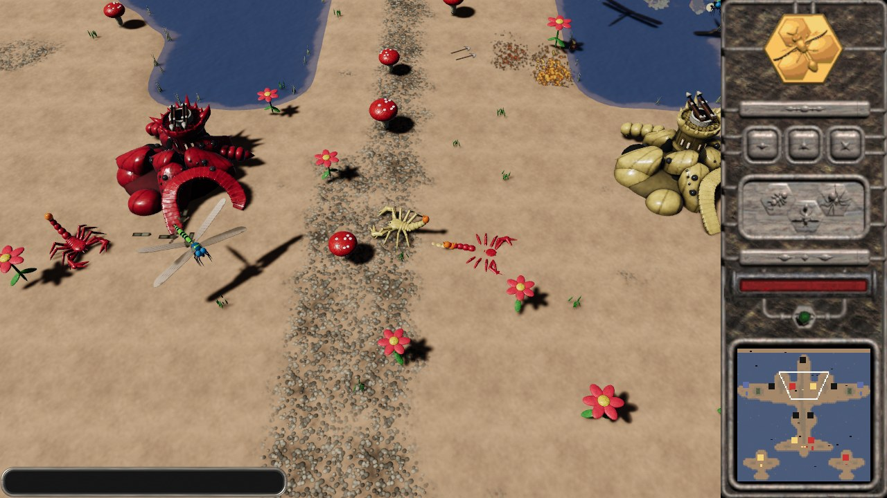
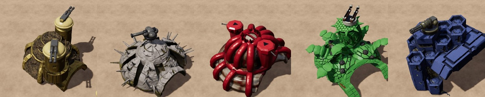
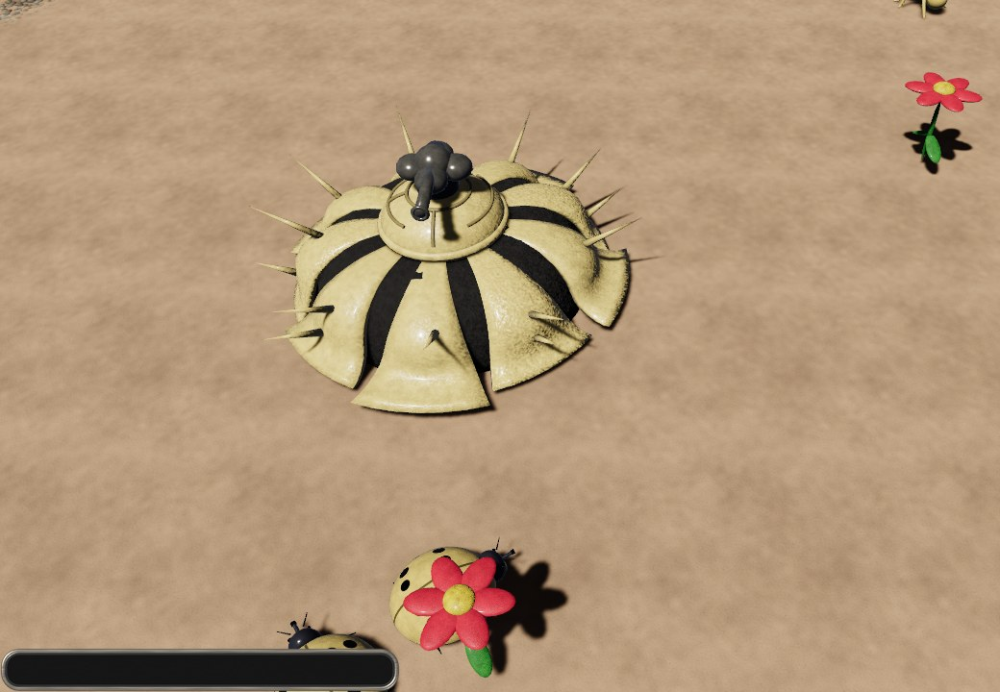
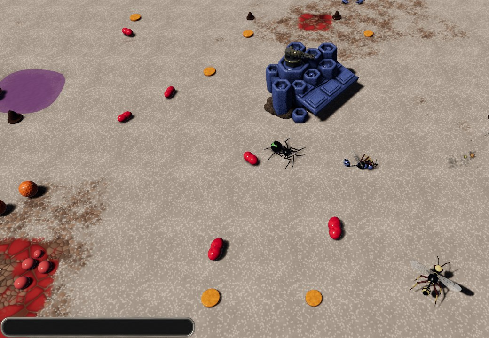
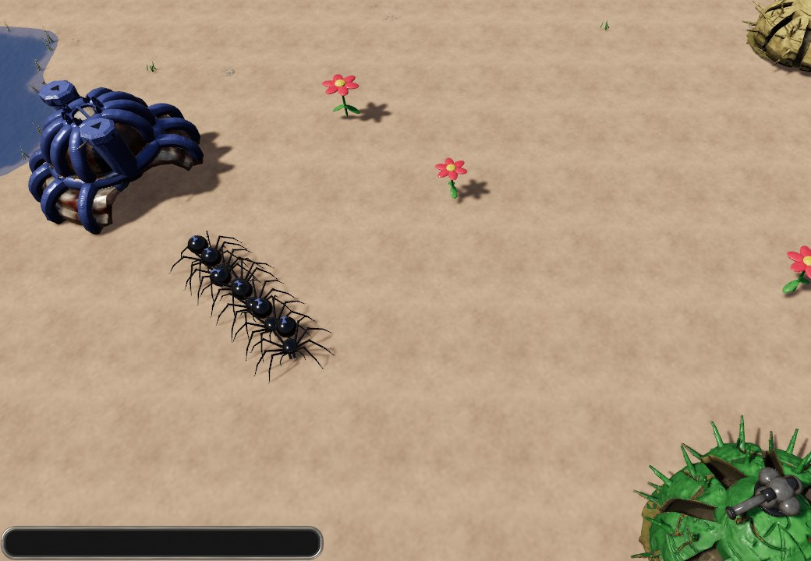
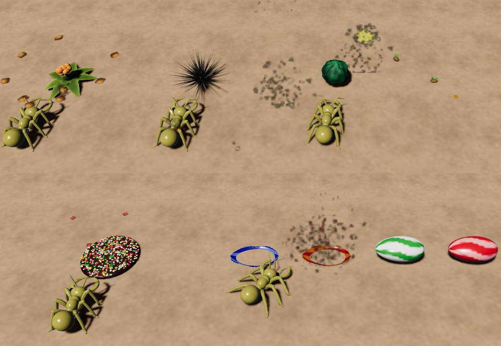

# Swarm Assault 3D Redux

A faithful 3-D recreation of *Swarm Assault* (Gate 5 Creations, 1999), the real-time strategy
game of warring bug colonies, rebuilt from scratch in Rust with [Bevy](https://bevy.org).



*Level 56, Bomber Paradise: scorpions clash between their two colonies while a Dragonfly makes its
bombing run.*

Five bug families fight over colonies across the original's levels. The rules, levels and
interface are the original's; the battlefield is 3-D. Every bug, turret, plant and prop is a new
3-D model, rigged and animated in Blender by scripts kept in this repository; the colonies were
generated with Tripo from the original's colony pictures and finished in Blender the same way.
Each level's ground is built in 3-D from the original level layout. The code is all new: nothing
from the 1999 game is copied into this repository. If you own the original, the game reads its
interface, menus, ground tiles, effects and sounds from your copy while it runs.

On top of the original, Redux adds a twist of its own: beat the campaign and an endless
**Procedural Mode** opens up, with new generated levels that keep getting harder.

**Status:** work in progress, playable on Windows. Every level loads and runs (checked by the
test suite). Being worked on now: each bug's attack animation, matched to the original's attack
frames.

## Features

### Five bug families

| Family | Light | Medium | Heavy |
|---|---|---|---|
| Ants | Ant Soldier: bites | Ant Grenadier: grenades | Ant Bazooka: rockets |
| Beetles | Lady Bug: heavy machine gun | Shrapnel Beetle: shrapnel | Cannon Beetle: long-range cannon |
| Spiders | Black Widow: fast melee | Spider Sniper: sniper rifle | Missile Spider: homing missiles |
| Scorpions | Savage Scorpion: sting | Spear Gun Scorpion: harpoons | Ninja Scorpion: ninja stars |
| Wasps | Assault Wasp: machine gun | Paralysis Wasp: paralysis darts | Sonic Wasp: sonic beam |

Each unit has its own model, movement and weapon. The Missile Spider's rockets chase a moving
target and loop back round until they hit.

### Colonies



Each family's colony breeds its three units and defends itself with turrets. Destroy an enemy
colony and it scatters bits: collect more of them than anyone else and the colony is yours, as
in the original. Turret structures (tesla coils among them) and boosters stand where the
original levels put them.

The colony models began as 3-D models that Tripo generated from the original's colony pictures.
In Blender each one was stood level, fitted to the original's camera view and textured in its
team colour. The turrets sit where the original mounts them: the ant's twin machine guns, the
beetle's cannon, the spider's sniper barrels in its two towers, the scorpion's spear launcher and
the wasp's chain gun. New bugs walk out of the colony's doorway.

### Neutral creatures

Every level brings the original's neutral creatures, in the numbers the original level sets:

* **Creep plants** that grow, fight back and regrow: the Popcorn Plant, Thorn Bush, Seed Ball
  (it bursts and scatters seeds that grow into new Seed Balls), Choc Freckle and the Death
  Lollies.
* **Flyers** with their bombing runs: the Dragonfly bombs both sides of its path, the Desert
  Fly's bombs split in two, the Spawn Moth sows seeds, and a shot-down Flying Machine drops its
  pilot.

### All the levels

The original's 100 campaign levels and its 24 custom and skirmish maps, with their terrain
(grass, desert, swamp and candy), colonies, turrets, boosters, creatures and start positions,
plus two demo maps. Campaign levels unlock one after another.

### Procedural Mode: our own twist

This is not in the 1999 game; it is Redux's own addition. Finish the campaign and a
**Procedural Mode** button appears on the main menu: an endless run of new maps. Every map is made from scratch with a name to match. Its ground is laid with the
original's own ground pieces, in the patterns the original levels use, so the shores, rocks and
scrub look like a real Swarm Assault level. Colonies, armies, plants, flyers and props are placed
on top. Win and **Next Level** takes you on to a harder map: more enemy teams (up to three), more
enemy colonies, turrets and starting units, smarter bots, then ever faster enemy breeding. It
never ends. Lose and you can retry the same map; the game remembers how far you got.

### The original's look and sound, from your own copy

Point the game at your copy of the original and it uses the original's ground tiles, the
sidebar with its radar and breeding buttons, the cursors, title screen, main menu, level list and
loading screens, the in-game menu (casualties, colony takeovers, time and volume), the YOU WIN /
GAME OVER sign, health bars beside selected units and colonies, explosions, projectiles,
portraits and sounds. None of it is in this repository or in the game package. Without a copy
the game uses its own look-alike interface and sound set. The screenshots on this page were
taken with a copy installed.

### Also

* Cheat console: press Enter and type `cheat` for the cheat menu (win the level, unlock all
  levels, invincibility, fast breeding, no unit cap, heal, capture everything, destroy the
  enemies, spawn units); `help` lists the typed commands.
* Quick save and load, pause and game speed.
* Settings: sound volume (it starts at 0), sound on/off, fullscreen and vsync, saved in
  `assets/data/settings.ron`.

## Screenshots

| | |
|---|---|
| <br>A beetle colony and its cannon; new Lady Bugs leave through the doorway | <br>A candy level: a wasp colony and its Assault Wasps |
| <br>Black Widows march out of a spider colony | <br>Creep plants: two Death Lollies have just gone off |

## Playing

Windows 10 or 11 (64-bit) with a graphics card that runs Vulkan or DirectX 12. Start
`swarm_assault_3d.exe` with the `assets` folder next to it.

To use the original's look and sound, put your copy of *Swarm Assault* in a folder named
`original_game\Swarm Assault` inside the game folder or in the folder above it, or set
`original_game_dir` in `assets/data/settings.ron` to the folder that holds `Game\Game.DDF`. A copy
installed in `C:\Program Files (x86)\Swarm Assault` is found too.

| Control | Action |
|---|---|
| Left click, left drag | select units or a colony |
| Double click a bug | select every bug of that kind on the screen |
| Right click | move or attack |
| T | attack-move |
| X | stop |
| C | select all units |
| 1, 2, 3 (colony selected) | breed its light, medium or heavy unit; 0 stops breeding |
| R (colony selected) | set the rally point |
| W A S D, arrow keys, screen edges, middle drag | scroll |
| Mouse wheel, + and - | zoom |
| Q, E | rotate the view |
| Space | pause |
| [ and ] | game speed |
| F5, F9 | quick save, quick load |
| F12 | screenshot |
| Esc | menu |
| Enter | console |
| F1 | controls help |

Key bindings are in `assets/data/controls.ron`.

## Building from source

Install Rust with [rustup](https://rustup.rs); the toolchain version is pinned in
`source/rust-toolchain.toml` and installed on the first build.

```powershell
git clone https://github.com/mike70727/SwarmAssault3D_Redux.git
cd SwarmAssault3D_Redux\source
cargo build --release -p swarm_assault_3d
cargo test -p sa_sim
cd ..
.\source\target\release\swarm_assault_3d.exe
```

Start the game from the repository root so it finds `assets` (or set the `SA_ASSETS` variable).
More in [docs/BUILD_WINDOWS.md](docs/BUILD_WINDOWS.md).

## Repository layout

| Path | Contents |
|---|---|
| `source/crates/sa_sim` | the game rules: a deterministic simulation with no graphics (units, weapons, projectiles, colonies and capture, creeps, bots, victory, save and load, the procedural level generator) and its tests |
| `source/crates/sa_game` | the Bevy game: camera, selection and orders, models and animation, ground, interface, menus, sound, the reader for the original's files |
| `source/blender` | Blender Python scripts that build every model, the `.blend` sources and preview renders |
| `source/tools` | level converter, sound and interface generators, packaging scripts |
| `assets/models`, `assets/textures` | the exported models (GLB) and their textures |
| `assets/data` | units and weapons, colonies, rules, the 126 levels, controls and settings (RON text files) |
| `docs` | gameplay research, asset and level notes, build notes |

## Faithfulness

Health, damage and range of every bug, neutral creature and colony turret are the original
program's own numbers, read from its code. Other unit and colony numbers come from OpenSA, a fan
re-implementation of *Swarm Assault* on the OpenRA engine. Where the original's own data files
could settle a question (creature counts per level, animations, turret mounts, the interface
layout), they did. [docs/GAMEPLAY_RESEARCH.md](docs/GAMEPLAY_RESEARCH.md) lists what is verified
and what is assumed. Procedural Mode is the one deliberate addition.

## Credits and license

* *Swarm Assault* was made by Gate 5 Creations in 1999 and published by Mountain King Studios.
  This is an unofficial fan recreation, not affiliated with or endorsed by them.
* The levels were converted from the OpenSA project's maps ([docs/LEVELS.md](docs/LEVELS.md)).
* Built with [Bevy](https://bevy.org) and [Blender](https://www.blender.org); the colony models
  were generated with [Tripo](https://www.tripo3d.ai) by mike70727.
* Made by [mike70727](https://github.com/mike70727), with Claude (Anthropic) writing the code,
  models and animation.

Swarm Assault 3D Redux is free software, under the same license as OpenSA: you can
redistribute it and/or modify it under the terms of the GNU General Public License as published
by the Free Software Foundation, either version 3 of the License, or (at your option) any later
version ([LICENSE](LICENSE)). Whoever passes it on, changed or not, must pass on its source code
under the same license. It is a free fan project and is not for sale. It comes with no warranty.
The original game's files are not included and are not covered by this license.
