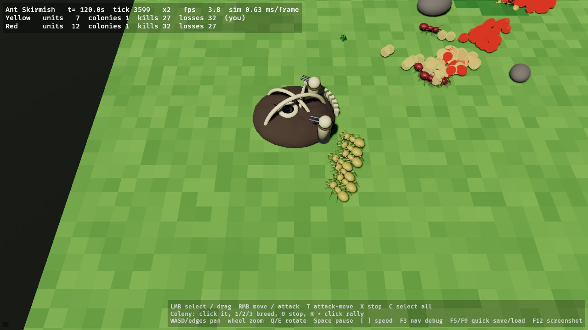
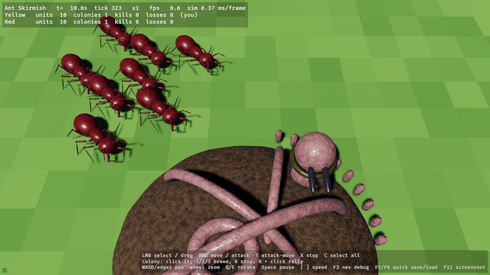

# Swarm Assault 3D

A playable 3-D recreation of *Swarm Assault* (1999) for modern Windows PCs, written in Rust with
[Bevy 0.20](https://bevy.org) and with every unit, colony and prop modelled, rigged and animated by
repeatable Blender Python scripts.



* Five bug families (Ants, Beetles, Spiders, Scorpions, Wasps), 21 units, five colony types with
  rotating turrets, neutral flyers and pirate ants.
* Top-down RTS camera, click/drag selection, move / attack / attack-move orders, colony breeding,
  the original colony-capture flow (destroy a colony, collect more of its scattered bits than the
  enemy), bots, victory and defeat.
* Deterministic simulation (`crates/sa_sim`, no rendering dependencies) separated from the Bevy
  presentation layer (`crates/sa_game`); editable RON data for units, weapons, colonies, maps,
  controls and settings; save/load; menus; audio hooks; benchmark mode.
* The original's interface, rebuilt: the stone-and-steel sidebar (game timer, the faction
  insignia that opens the options menu, the radar, the three breeding buttons with their red
  progress bars and the LED), a selection screen under it, the black message bar, stone dialogs
  with bronze buttons, red cursors (arrow, crosshair over enemies, selection bracket) and a bold
  sans font. All the chrome is rendered in Blender (`blender/scripts/build_ui_chrome.py`, own
  artwork laid out to the original's 226x448 panel; `docs/ASSET_NOTES.md`, "Interface chrome").
  No statistics on screen (F3 shows them, F1 the controls). Campaign levels unlock one after
  another; the level-complete screen leads to the next level (`saves/progress.ron`).
* Sound: a full synthesized effect set (`tools/make_sounds.py`, 40 Ogg Vorbis files in
  `assets/audio/`) covers every audio hook: weapons, impacts, deaths per family, colony events,
  bit pickup, unit ready, victory / defeat and the interface click (`docs/AUDIO_HOOKS.md`).
* Settings dialog (main menu and the in-game options menu): sound volume slider, sound on/off,
  fullscreen and vsync toggles, applied at once and saved to `assets/data/settings.ron`.
* Console: Enter opens a text bar; typing `cheat` opens the cheat menu (win the level, unlock all
  levels, invincibility, fast breeding, no unit cap, heal, capture everything, destroy enemies,
  spawn units); `help` lists the typed commands.
* All the levels: the 100 campaign levels, 13 custom missions and 11 skirmish maps of the
  original, converted from the OpenSA map data with exact terrain, colonies, turrets, boosters,
  units and start cameras (`docs/LEVELS.md`), plus the two demo maps; paged level select.
* Realism pass on every model: subdivided bodies, procedural chitin / metal / membrane / fur
  surfaces baked to colour, roughness-metallic and normal textures (`docs/ASSET_NOTES.md`,
  "Realism pass"); team colour stays a runtime tint over the textures.



## Quick start

```bash
cargo run --release -p swarm_assault_3d            # main menu
cargo run --release -p swarm_assault_3d -- --map five_families.ron
cargo test -p sa_sim                               # headless gameplay tests
cargo run --release -p sa_sim --example bench_sim  # simulation benchmark
```

Linux build dependencies: `libasound2-dev libudev-dev libwayland-dev libxkbcommon-dev pkg-config`.
Windows: see `docs/BUILD_WINDOWS.md` (native build) – `tools/package_windows.sh` builds the
cross-compiled release zip (`dist/SwarmAssault3D-windows-x64.zip`, not committed).

Verification status: everything was built and tested on a Linux container without a GPU (software
Vulkan); see `docs/TEST_REPORT.md` for what was measured and what still needs a Windows machine.

## Repository layout

| Path | Contents |
|---|---|
| `crates/sa_sim` | simulation: nav grid, units, weapons, projectiles, colonies & capture, bots, victory, save/load, tests |
| `crates/sa_game` | Bevy app: camera, input/selection, views & animation, HUD, menus, audio hooks, screenshots, benchmark |
| `assets/data` | `units.ron`, `colonies.ron`, `rules.ron`, `maps/*.ron` (126 levels), `controls.ron`, `settings.ron` |
| `assets/models`, `assets/textures` | exported GLB models (47: 21 units, 5 colonies, 9 level structures, 12 props) and their baked textures |
| `blender/scripts` | bpy scripts that build every asset (`salib.py` shared library) |
| `blender/blend`, `blender/previews` | editable sources (textures packed, procedural `M_*_proc` materials kept) and front/back/left/right/three-quarter renders |
| `docs` | plan, gameplay research (verified vs assumed), asset notes, levels, test/benchmark reports, Windows build |
| `tools` | packaging scripts (Windows build zip, model pack split into download-sized parts), headless runner, OpenSA level converter |

## Faithfulness notes

Unit and colony statistics are converted from the OpenSA re-implementation and tagged as such in
the data files; they are **not** verified original values (see `docs/GAMEPLAY_RESEARCH.md`).
Provisional behaviour is labelled in code, data and docs. No original artwork or audio is shipped.
